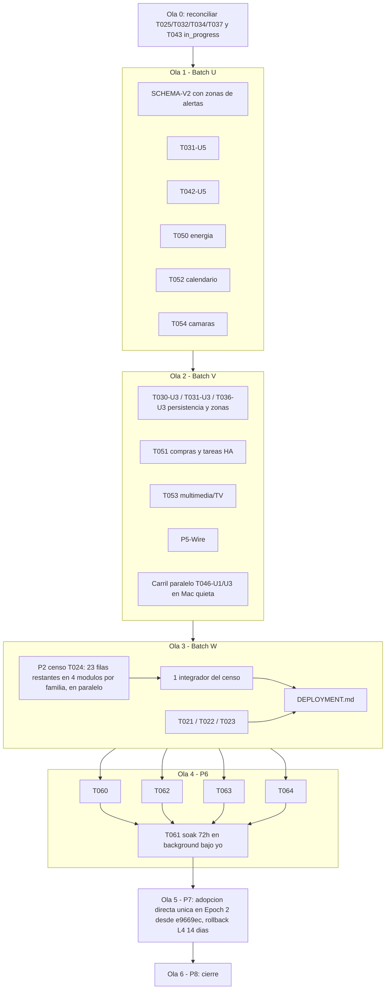

# Roadmap de Precedencia y Estrategia de Tests (Ola 0)

- **Fecha:** 2026-11-21
- **Alcance:** orden de ejecución de las olas restantes del roadmap autónomo (`docs/plans/2026-11-02-autonomous-roadmap.json`), reparto de archivos entre especialistas y estrategia de tests acordada el 2026-11-21.
- **Estado:** plan de coordinación. No acepta ningún criterio (`criteria` sigue sin `accepted`); los hashes `acceptance_targets_sha256` y `profile_sha256` no cambian.

## Ola 0: reconciliación (esta entrega)

T025, T032, T034 y T037 pasan a `verified_local` porque su código local está 100 % fusionado en la rama base. T043 pasa de `planned` a `in_progress` con los commits de T043-U1 y T043-U2 (Batch N). `verified_local` no significa aceptación: la prueba física de Cocina (C19/C20) queda en P7/T070 y C13 de campo y el pronóstico en vivo quedan para P7. T031-U4 fue descartada por decisión Q7.

## Grafo de precedencia

Notas de precedencia:

- La Ola 2 depende de SCHEMA-V2 (Ola 1): T030-U3/T031-U3/T036-U3 persisten zonas y alertas sobre ese esquema.
- El carril T046-U1/U3 (medición) corre en Mac quieta; no comparte archivos con el resto y no bloquea la Ola 2.
- T061 (soak 72 h) arranca en background bajo `yo` cuando T060, T062, T063 y T064 terminaron; mientras corre no se tocan archivos de runtime.
- P7 es una adopción directa única en Epoch 2 desde `e9669ec`, con rollback L4 de 14 días; P8 cierra solo con criterios y aceptación completos.

## Partición de archivos disjuntos por ola

Regla: hasta 7 especialistas simultáneos + 1 orquestador. Cada especialista tiene un worktree propio y un conjunto de archivos que ningún otro toca en la misma ola. El orquestador no implementa código de aplicación; solo edita roadmap/docs de coordinación tras integrar. Si dos unidades necesitan el mismo archivo, se serializan o se parte la unidad.

Los directorios son orientativos: el analista (`kza-analista`) confirma el conjunto exacto en la Spec `<= 2 KB` antes de despachar, y cualquier colisión detectada se resuelve moviendo la unidad a la ola siguiente.

| Ola | Especialista | Unidad | Área de archivos propia (disjunta) |
|---|---|---|---|
| 1 | E1 | SCHEMA-V2 (incluye zonas de alertas T036-U3) | esquema y migraciones de persistencia (`src/` de store/schema) y sus tests |
| 1 | E2 | T031-U5 | recordatorios por voz (`src/reminders/`, tests `tests/unit/reminders/`) |
| 1 | E3 | T042-U5 | superficie dashboard/OBS pendiente de T042 (`src/dashboard/frontend/obs/`) |
| 1 | E4 | T050 | integración energía (módulo nuevo `src/` de energía y sus tests) |
| 1 | E5 | T052 | calendario dual (módulo nuevo de calendario y sus tests) |
| 1 | E6 | T054 | eventos técnicos de cámaras (módulo nuevo y sus tests) |
| 1 | Orq. | roadmap y coordinación | `docs/plans/*` |
| 2 | E1 | T030-U3, T031-U3, T036-U3 | persistencia y zonas sobre SCHEMA-V2 |
| 2 | E2 | T051 | compras/tareas HA (módulo de listas y sus tests) |
| 2 | E3 | T053 | multimedia/TV (módulo de media y sus tests) |
| 2 | E4 | P5-Wire | cableado de la cadena de DI (`src/main.py` solo con revisión de DI completa; un único dueño) |
| 2 | E5 | T046-U1/U3 | medición en Mac quieta (`scripts/` de baseline y reportes; sin `src/`) |
| 3 | E1-E4 | T024: 23 filas restantes | 4 módulos de censo, uno por familia, en paralelo |
| 3 | E5 | integrador del censo | consolida los 4 módulos; empieza cuando E1-E4 fusionaron |
| 3 | E6 | T021 / T022 / T023 | cierres nativos estrictos en sus rutas propias |
| 3 | E7 | `DEPLOYMENT.md` | `docs/architecture/DEPLOYMENT.md` |
| 4 | E1-E4 | T060 / T062 / T063 / T064 | un especialista por tarea, en paralelo |
| 4 | `yo` (background) | T061 | soak 72 h, solo lectura sobre artefactos construidos |

## Estrategia Cero Tiempo Muerto en Tests (acordada el 2026-11-21)

### Doble Buffer

Mientras la validación de la Ola N corre (por ejemplo en `kza-yo`), los especialistas de la Ola N+1 ya implementan en sus worktrees. Cuando la validación de N termina en verde se integra N y se rebasan los worktrees de N+1; si falla, se corrige en N sin descartar el trabajo de N+1. El orquestador nunca espera en vacío: despacha N+1 antes de lanzar la validación de N.

### Gate por impacto

- **Tier 1** (rápido, sin systemd, 3-5 min): gate por defecto de cada unidad y de cada ola cuyo cambio no toca runtime compilado, systemd ni adopción.
- **Tier 2** (gate completo): solo cuando el cambio toca bytecode/`build_runtime`, systemd, adopción/rollback, esquema persistente de release, o antes de P7. Se corre como `yo` en `kza-yo`.
- Tier 0 queda para feedback del asiento (15-45 s) con `--targets`.

### T090-U6

Extensión del runner (`scripts/run_test_suite.py`) con:

- `--lanes`: selección explícita de carriles para ejecutar solo los afectados.
- Guarda anti-thermouy: el runner aborta si detecta carga térmica o de CPU fuera de la ventana reservada, para no falsear presupuestos de tiempo.
- `NI=5` nativo con `--workers 6` en `taskset -c 24-47`, sin depender de `nice` externo, dentro de los límites de `yo` (`MemoryHigh=32 GiB`, `MemorySwapMax=0`).

Esto no relaja oráculos, timeouts ni el chequeo `before_NRestarts == after_NRestarts` de `systemd-journald`.

### Decisiones de autoridad acordadas

| Tema | Decisión |
|---|---|
| T051 | Sincronización **bidireccional con HA para todo** (compras y tareas) |
| T052 | Calendario **dual**: archivo `.ics` local + entidades `calendar.*` de HA |
| SCHEMA-V2 | Incluye las **zonas de alertas** (T036-U3) desde su primera versión |

## Límites

- Ningún paso de este plan promueve criterios a `accepted`; la aceptación sigue dependiendo de P7/P8.
- Nada se edita ni se publica en `/home/kza/*`; la adopción y las releases siguen el GO explícito de release.
