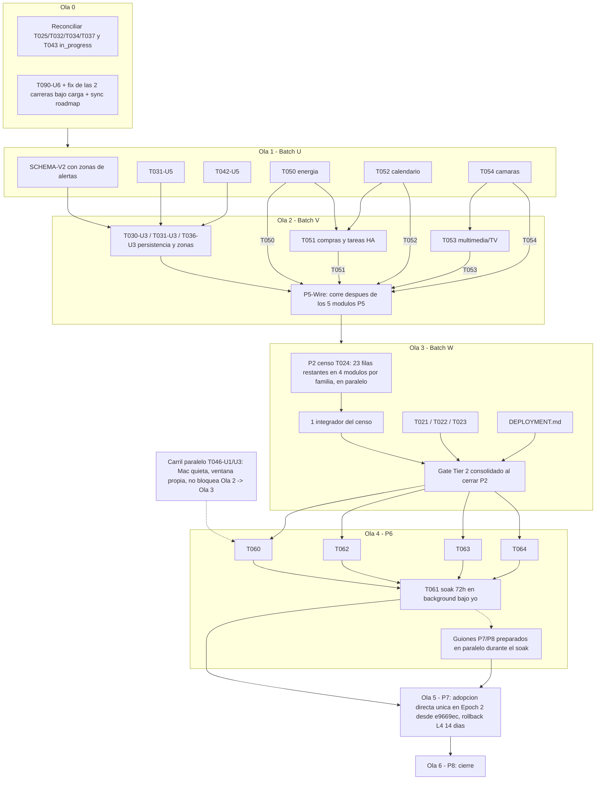

# Roadmap de Precedencia y Estrategia de Tests (Ola 0)

- **Fecha:** 2026-11-21
- **Alcance:** orden de ejecución de las olas restantes del roadmap autónomo (`docs/plans/2026-11-02-autonomous-roadmap.json`), reparto de archivos entre especialistas y estrategia de tests acordada el 2026-11-21.
- **Estado:** plan de coordinación. No acepta ningún criterio (`criteria` sigue sin `accepted`); los hashes `acceptance_targets_sha256` y `profile_sha256` no cambian.

## Ola 0: reconciliación (esta entrega)

T025, T032, T034 y T037 pasan a `verified_local` porque su código local está 100 % fusionado en la rama base. T043 pasa de `planned` a `in_progress` con los commits de T043-U1 y T043-U2 (Batch N). `verified_local` no significa aceptación: la prueba física de Cocina (C19/C20) queda en P7/T070; C13 de campo y el pronóstico en vivo quedan para P7, y la consolidación de regresión en T060 verificará Q22 (los casos de estado cubren HTTP de diagnóstico) junto con C13 y el pronóstico real. T031-U4 fue descartada por decisión Q7.

La Ola 0 incluye además T090-U6 (`--lanes`, guarda anti-thermouy, `NI=5` nativo), el arreglo de las 2 carreras observadas bajo carga y la sincronización del roadmap.

## Grafo de precedencia

Notas de precedencia:

- Los cinco módulos P5 (T050, T051, T052, T053, T054) alimentan P5-Wire, que corre después de ellos en la Ola 2. Los de la Ola 1 (T050, T052, T054) ya están listos; T051 y T053 se completan en la Ola 2 y P5-Wire cierra la ola.
- La Ola 2 depende de SCHEMA-V2 (Ola 1): T030-U3/T031-U3/T036-U3 persisten zonas y alertas sobre ese esquema.
- T046-U1/U3 es un carril paralelo sujeto a una ventana de Mac quieta: no bloquea el paso de Ola 2 a Ola 3; su medición debe estar lista antes de T060 y T062.
- T061 (soak 72 h) arranca en background bajo `yo` cuando T060, T062, T063 y T064 terminaron. Durante esas 72 h se preparan en paralelo los guiones de P7 y P8, antes de la adopción directa única en P7.
- P7 es una adopción directa única en Epoch 2 desde `e9669ec`, con rollback L4 de 14 días; P8 cierra solo con criterios y aceptación completos.

## Partición de archivos disjuntos por ola

Regla: hasta 7 especialistas simultáneos + 1 orquestador. Cada especialista tiene un worktree propio y un conjunto de archivos que ningún otro toca en la misma ola. El orquestador no implementa código de aplicación; solo edita roadmap/docs de coordinación tras integrar. Si dos unidades necesitan el mismo archivo, se serializan o se parte la unidad.

Los directorios son orientativos: el analista (`kza-analista`) confirma el conjunto exacto en la Spec `<= 2 KB` antes de despachar, y cualquier colisión detectada se resuelve moviendo la unidad a la ola siguiente.

| Ola | Especialista | Unidad | Área de archivos propia (disjunta) |
|---|---|---|---|
| 1 | E1 | SCHEMA-V2 (incluye zonas de alertas T036-U3) | esquema y migraciones de persistencia (`src/` de store/schema) y sus tests |
| 1 | E2 | T031-U5 | recordatorios por voz (`src/reminders/`, tests `tests/unit/reminders/`) |
| 1 | E3 | T042-U5 | superficie dashboard/OBS pendiente de T042 (`src/dashboard/frontend/obs/`) |
| 1 | E4 | T050 | integración energía (módulo nuevo `src/` de energía y sus tests) |
| 1 | E5 | T052 | calendario dual (módulo nuevo de calendario y sus tests) |
| 1 | E6 | T054 | eventos técnicos de cámaras (módulo nuevo y sus tests) |
| 1 | Orq. | roadmap y coordinación | `docs/plans/*` |
| 2 | E1 | T030-U3, T031-U3, T036-U3 | persistencia y zonas sobre SCHEMA-V2 |
| 2 | E2 | T051 | compras/tareas HA (módulo de listas y sus tests) |
| 2 | E3 | T053 | multimedia/TV (módulo de media y sus tests) |
| 2 | E4 | P5-Wire | cableado de la cadena de DI (`src/main.py` solo con revisión de DI completa; un único dueño) |
| 2 | E5 | T046-U1/U3 | medición en Mac quieta (`scripts/` de baseline y reportes; sin `src/`) |
| 3 | E1-E4 | T024: 23 filas restantes | 4 módulos de censo, uno por familia, en paralelo |
| 3 | E5 | integrador del censo | consolida los 4 módulos; empieza cuando E1-E4 fusionaron |
| 3 | E6 | T021 / T022 / T023 | cierres nativos estrictos en sus rutas propias |
| 3 | E7 | `DEPLOYMENT.md` | `docs/architecture/DEPLOYMENT.md` |
| 4 | E1-E4 | T060 / T062 / T063 / T064 | un especialista por tarea, en paralelo |
| 4 | `yo` (background) | T061 | soak 72 h, solo lectura sobre artefactos construidos |

## Estrategia Cero Tiempo Muerto en Tests (acordada el 2026-11-21)

### Doble Buffer

Mientras la validación de la Ola N corre (por ejemplo en `kza-yo`), los especialistas de la Ola N+1 ya implementan en sus worktrees. El orquestador despacha N+1 antes de lanzar la validación de N.

- Si N termina en verde, se integra N y se rebasan los worktrees de N+1.
- Si falla por un fix de código, se corrige en N y **se rebasa la Ola N+1** sobre el nuevo SHA.
- Ante interferencia externa (pre-flight ThermoUY: `thermouy-tier2-nightly` y `thermouy-ci-prune`), se **re-ejecuta solo el carril afectado en el mismo SHA**, sin rebase ni re-corrida completa.

### Gate por impacto

- **Tier 0** (feedback de asiento, 15-45 s): `--targets` sobre los tests afectados.
- **Tier 1** (sin systemd): gate por defecto de cada lote. Referencia de duración por lote: **~15-20 min** (el objetivo histórico de 3-5 min es del runner en una corrida aislada, no del lote completo con revisión).
- **Tier 2 obligatorio** (como `yo` en `kza-yo`) cuando se cumple cualquiera de estas condiciones:
  - el lote toca **release** (`build_runtime`, bytecode, manifiesto, adopción/rollback);
  - el lote toca **systemd**;
  - el lote toca **esquema** (SCHEMA-V2);
  - el lote toca **privacidad** (T021-T024, `output_registration`);
  - **al cerrar cada Fase**, incluido el **Gate Tier 2 consolidado obligatorio al cerrar P2 en la Ola 3**, y antes de P7.

### T090-U6

Extensión del runner (`scripts/run_test_suite.py`) con:

- `--lanes`: selección explícita de carriles para ejecutar solo los afectados (base de la re-ejecución por carril).
- Guarda anti-thermouy: el runner detecta la interferencia de los jobs ThermoUY y la reporta/aborta en vez de falsear presupuestos de tiempo.
- `NI=5` nativo con `--workers 6` en `taskset -c 24-47`, sin depender de `nice` externo, dentro de los límites de `yo` (`MemoryHigh=32 GiB`, `MemorySwapMax=0`).

No relaja oráculos, timeouts ni el chequeo `before_NRestarts == after_NRestarts` de `systemd-journald`.

### Decisiones de autoridad acordadas

| Tema | Decisión |
|---|---|
| T051 (Q5) | Reconciliación bidireccional determinista **únicamente** sobre la entidad `todo` compartida elegida de Home Assistant: las altas se deduplican sin distinguir mayúsculas; ante conflicto en estado completado/borrado gana la mutación más reciente y, si HA no trae timestamp, prevalece el estado actual de HA al reconectar. Las **listas personales permanecen 100 % locales en KZA**, sin exposición a HA ni a visitas. |
| T052 (Q6) | Calendario dual, ambos adaptadores **estrictamente de solo lectura**: archivo `.ics` privado bajo `state/data/` y entidades `calendar.*` de HA. |
| SCHEMA-V2 (Q3) | Incluye las zonas de alertas (T036-U3): las zonas elegidas en la web se persisten de forma durable, en una sola subida a Epoch 2, en `reminders.db` (SCHEMA-V2), con fallback a `config/settings.yaml`. |
| Soak (Q8) | Durante las 72 h de T061 bajo `yo` se preparan en paralelo los guiones de P7/P8, antes de la adopción directa única en P7. |

## Límites

- Ningún paso de este plan promueve criterios a `accepted`; la aceptación sigue dependiendo de P7/P8.
- Nada se edita ni se publica en `/home/kza/*`; la adopción y las releases siguen el GO explícito de release.
